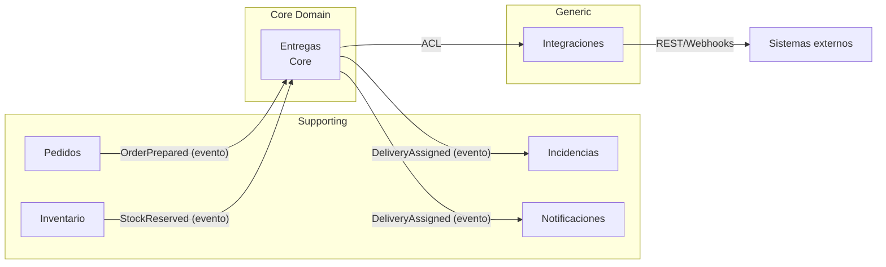

# Bounded Contexts y Context Map

## Contextos delimitados

Cada contexto tiene su propio modelo, su propio lenguaje y sus propias reglas.
Un mismo término puede significar cosas distintas en contextos distintos; por
eso "Entrega" en Entregas no es lo mismo que "Entrega" en Pedidos.

| Bounded Context | Tipo | Responsabilidad | Entidades núcleo |
|---|---|---|---|
| **Entregas** | Core | Asignar, rutar y seguir entregas | `Delivery`, `Route`, `Courier` |
| **Pedidos** | Supporting | Gestionar la intención de compra y su estado único | `Order`, `OrderLine` |
| **Inventario** | Supporting | Consolidar y reservar stock por nodo | `Inventory`, `StockReservation` |
| **Incidencias** | Supporting | Gestionar desviaciones | `Incident` |
| **Notificaciones** | Generic | Comunicar al cliente | `Notification` |
| **Integraciones** | Generic | Aislar sistemas externos | Adaptadores |

### Por qué Entregas es Core

Es donde vive la ventaja competitiva del sistema: la asignación y el
seguimiento de la última milla. Pedidos, Inventario, Incidencias y
Notificaciones son necesarios, pero no diferenciadores. Integraciones es
genérico porque solo traduce contratos externos.

## Context Map

## Relaciones entre contextos

| Origen | Destino | Patrón | Qué intercambian |
|---|---|---|---|
| Pedidos | Entregas | Customer / Supplier | Evento `OrderPrepared` con `OrderId` y líneas |
| Inventario | Entregas | Partnership | Evento `StockReserved` con `OrderId` y confirmación |
| Entregas | Notificaciones | Published Language | Evento `DeliveryAssigned` |
| Entregas | Incidencias | Published Language | Evento `DeliveryAssigned` y `DeliveryInRoute` |
| Entregas | Integraciones | Anti-Corruption Layer | Contrato para geolocalización y notificaciones push |
| Pedidos | Inventario | Customer / Supplier | Solicitud de reserva de stock |

## Qué NO cruza los límites

- Ningún contexto lee ni escribe las tablas de otro.
- Ningún contexto llama directamente a las clases de dominio de otro.
- La comunicación entre contextos es por **eventos** o por **interfaces públicas**.
- Los modelos no se comparten; si dos contextos necesitan el mismo dato, cada
  uno mantiene su propia representación.

## Lenguaje por contexto (ejemplo)

| Término | En Pedidos | En Entregas | En Inventario |
|---|---|---|---|
| "Entrega" | Fecha prometida al cliente | Unidad logística asignable | Salida de stock del nodo |
| "Estado" | Estado del pedido | Estado de la entrega | Estado de la reserva |
| "Confirmación" | Pago confirmado | Entrega confirmada por el repartidor | Stock descontado |