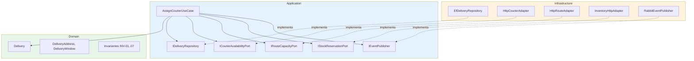

# 06.7 — Dirección de dependencias

## Regla

Las flechas de dependencia **siempre apuntan hacia el dominio**.
Infraestructura conoce a Aplicación y Dominio; nunca al revés.

## Consecuencias

- El dominio se prueba sin base de datos ni APIs.
- Cambiar de ORM o de proveedor no toca el dominio.
- Los tests de aplicación usan dobles de los puertos, no servicios reales.