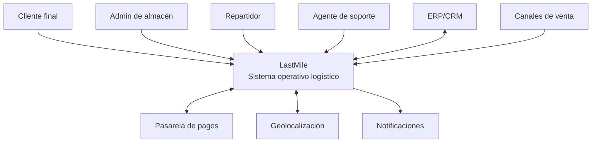
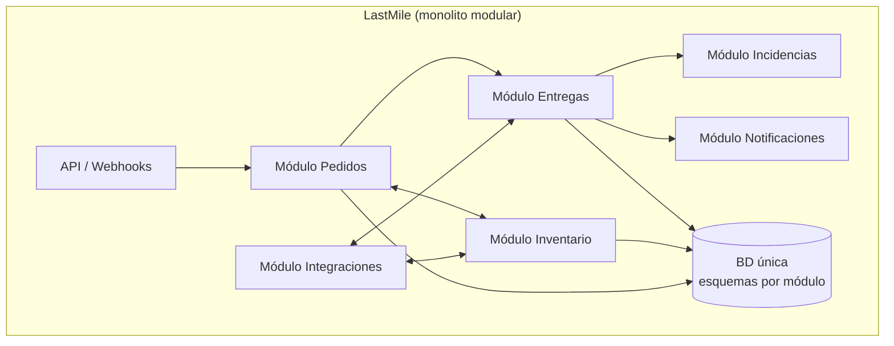
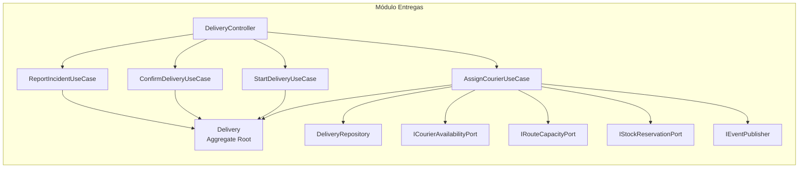
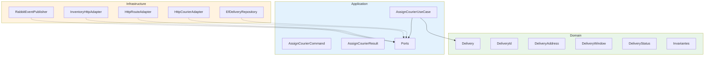

# Diagrama C4 actualizado — Actividad 3

Se mantienen los niveles 1 y 2 del ADR-001 y se agrega el nivel 3 para el
módulo Entregas, que es el flujo modelado en esta actividad.

## Nivel 1 — Contexto

## Nivel 2 — Contenedores

## Nivel 3 — Componentes del módulo Entregas

## Capas dentro del módulo Entregas

## Cambios respecto a la Actividad 2

| Elemento | Actividad 2 | Actividad 3 |
|---|---|---|
| C4 Nivel 1 | Definido | Sin cambios |
| C4 Nivel 2 | Definido | Sin cambios |
| C4 Nivel 3 | No existía | Agregado para el módulo Entregas |
| Context Map | No existía | Agregado (ver `05-bounded-contexts.md`) |
| Diagrama de capas | No existía | Agregado por módulo |
| ADR | ADR-001 (estructura) | ADR-002 (dominio del módulo Entregas) |